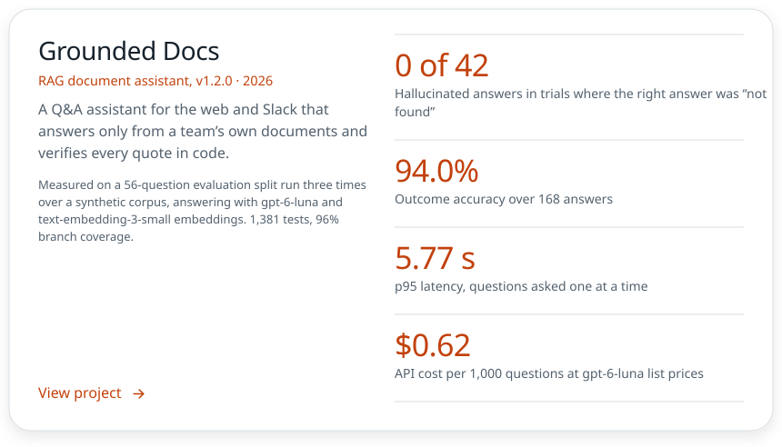

  <a href="https://tayeb-kahia.vercel.app/"><picture><source media="(prefers-color-scheme: dark)" srcset="assets/btn-portfolio-dark.svg"></picture></a>&nbsp;
  <a href="https://tayeb-kahia.vercel.app/tayeb_kahia_cv.pdf"><picture><source media="(prefers-color-scheme: dark)" srcset="assets/btn-cv-dark.svg"></picture></a>&nbsp;
  <a href="mailto:tayeb.kahia.ai@gmail.com"><picture><source media="(prefers-color-scheme: dark)" srcset="assets/btn-email-dark.svg"></picture></a>

I build AI systems and measure them, from fine-tuning and evaluating models to shipping them as tested, containerized services. Every result below says how it was measured.

## Projects

<a href="https://tayeb-kahia.vercel.app/projects/voice-swarm-edge">
  <picture>
    <source media="(prefers-color-scheme: dark)" srcset="assets/voice-swarm-edge-dark.svg">
    
  </picture>
</a>

[Project page](https://tayeb-kahia.vercel.app/projects/voice-swarm-edge) · [Repository](https://github.com/TayebKahia/voice-swarm-edge)

<a href="https://tayeb-kahia.vercel.app/projects/grounded-docs">
  <picture>
    <source media="(prefers-color-scheme: dark)" srcset="assets/grounded-docs-dark.svg">
    
  </picture>
</a>

[Project page](https://tayeb-kahia.vercel.app/projects/grounded-docs) · [Repository](https://github.com/TayebKahia/grounded-docs) · [Demo video (6.5 min)](https://github.com/TayebKahia/grounded-docs#-demo-video)

<a href="https://tayeb-kahia.vercel.app/projects/mailroom">
  <picture>
    <source media="(prefers-color-scheme: dark)" srcset="assets/mailroom-dark.svg">
    
  </picture>
</a>

[Project page](https://tayeb-kahia.vercel.app/projects/mailroom) · [Repository](https://github.com/TayebKahia/mailroom-showcase) · [Demo video (3.5 min)](https://github.com/TayebKahia/mailroom-showcase#demo) · [mailroom-mcp on PyPI](https://pypi.org/project/mailroom-mcp/)

The drones are simulated and the commands come from one speaker. Grounded Docs and Mailroom were evaluated on synthetic data, Mailroom on a pre-release build against fake services. None of these systems has real users or a hosted deployment.

## Other work

**[mailroom-mcp](https://github.com/TayebKahia/mailroom-mcp)** · 2026 
An MCP server for Mailroom, published on PyPI under the MIT license. Seven read and redraft tools; none can approve or send. [PyPI](https://pypi.org/project/mailroom-mcp/) · [Source](https://github.com/TayebKahia/mailroom-mcp)

**[WhatsApp Support Gateway](https://github.com/TayebKahia/whatsapp-support-gateway)** · 2026 
Backend work: a FastAPI webhook gateway for order tracking and returns. Rule-based, no LLM. Signature verification, duplicate-message protection and live handover to a human agent; 105 tests, Docker, CI.

**[CareerConnect](https://github.com/TayebKahia/CareerConnect)** · 2025 
A career recommendation engine built with graph neural networks and Sentence Transformers, as lead of a team of five.

## Skills

<picture>
  <source media="(prefers-color-scheme: dark)" srcset="assets/skills-dark.svg">
  
</picture>

## Background

**2021 to 2026 · École Supérieure en Informatique de Sidi Bel Abbès (ESI-SBA), Algeria** 
State Engineer and Master's degree in Computer Science, major in AI and Data Science. Theses: “Voice-Control for Drone Swarms Formation via Small LLM Models” and “Comparative Evaluation of Quantised Small Language Models for Grammar-Constrained Command Parsing on Edge Hardware”.

**2024 · Algérie Télécom (RMS Center), Blida** 
Network and security intern: enterprise networking and security.

**Languages** 
Arabic (native), English (fluent), French (proficient).

## Get in touch

I am based in Blida, Algeria. Email is the fastest way to reach me, and the [CV](https://tayeb-kahia.vercel.app/tayeb_kahia_cv.pdf) has the same projects on one page.

**[tayeb.kahia.ai@gmail.com](mailto:tayeb.kahia.ai@gmail.com)**
