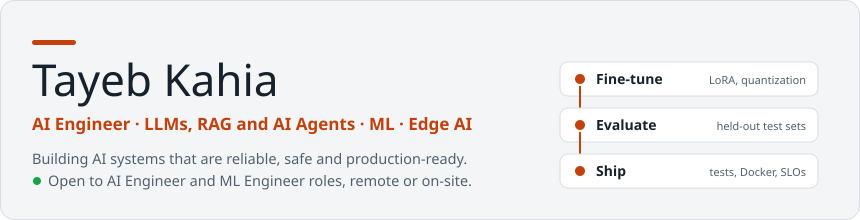
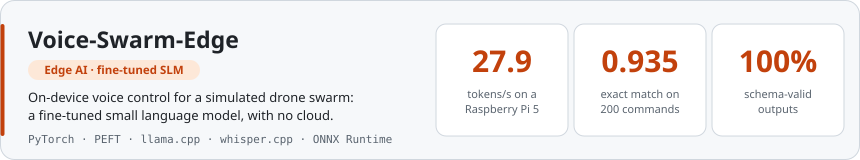
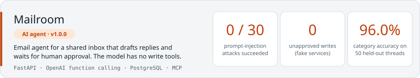

<picture>
  <source media="(prefers-color-scheme: dark)" srcset="assets/banner-dark.svg">
  
</picture>

  
  
  

I build AI systems and measure them, from fine-tuning and evaluating models to shipping them as tested, containerized services. I hold a State Engineer and Master's degree in AI and Data Science from ESI-SBA. I publish the results that missed their target next to the ones that hit it.

## Projects

<a href="https://github.com/TayebKahia/voice-swarm-edge">
  <picture>
    <source media="(prefers-color-scheme: dark)" srcset="assets/voice-swarm-edge-dark.svg">
    
  </picture>
</a>

<a href="https://github.com/TayebKahia/grounded-docs">
  <picture>
    <source media="(prefers-color-scheme: dark)" srcset="assets/grounded-docs-dark.svg">
    
  </picture>
</a>

<a href="https://github.com/TayebKahia/mailroom-showcase">
  <picture>
    <source media="(prefers-color-scheme: dark)" srcset="assets/mailroom-dark.svg">
    
  </picture>
</a>

Each card links to its repository. Conditions: the drones are simulated and the commands come from one speaker; Grounded Docs and Mailroom were evaluated on synthetic data, Mailroom on a pre-release build against fake services. Each repository has the full method and the misses.

## Also

- [**mailroom-mcp**](https://github.com/TayebKahia/mailroom-mcp): an MCP server for Mailroom, [published on PyPI](https://pypi.org/project/mailroom-mcp/). Seven read and redraft tools; none can approve or send.
- [**WhatsApp Support Gateway**](https://github.com/TayebKahia/whatsapp-support-gateway): a FastAPI webhook gateway for order tracking and returns, with signature verification, duplicate-message protection and handover to a human agent.
- [**CareerConnect**](https://github.com/TayebKahia/CareerConnect): a career recommendation engine built with graph neural networks and Sentence Transformers, as lead of a team of five.

## Skills

| Area | What I use |
| :-- | :-- |
| **LLM engineering** | RAG (hybrid search, pgvector, reciprocal rank fusion), tool calling, structured outputs, MCP servers, guardrails, prompt-injection defenses, human-in-the-loop approval, evaluation |
| **ML and edge AI** | PyTorch, Hugging Face Transformers, LoRA fine-tuning, quantization (GGUF, llama.cpp), grammar-constrained decoding, speech recognition |
| **Backend and data** | Python, SQL, FastAPI, Pydantic, PostgreSQL, REST, OAuth 2.0, WebSockets |
| **Operations and quality** | Docker, GitHub Actions, Grafana and SLOs, k6 load testing, pytest, mypy, Ruff |
